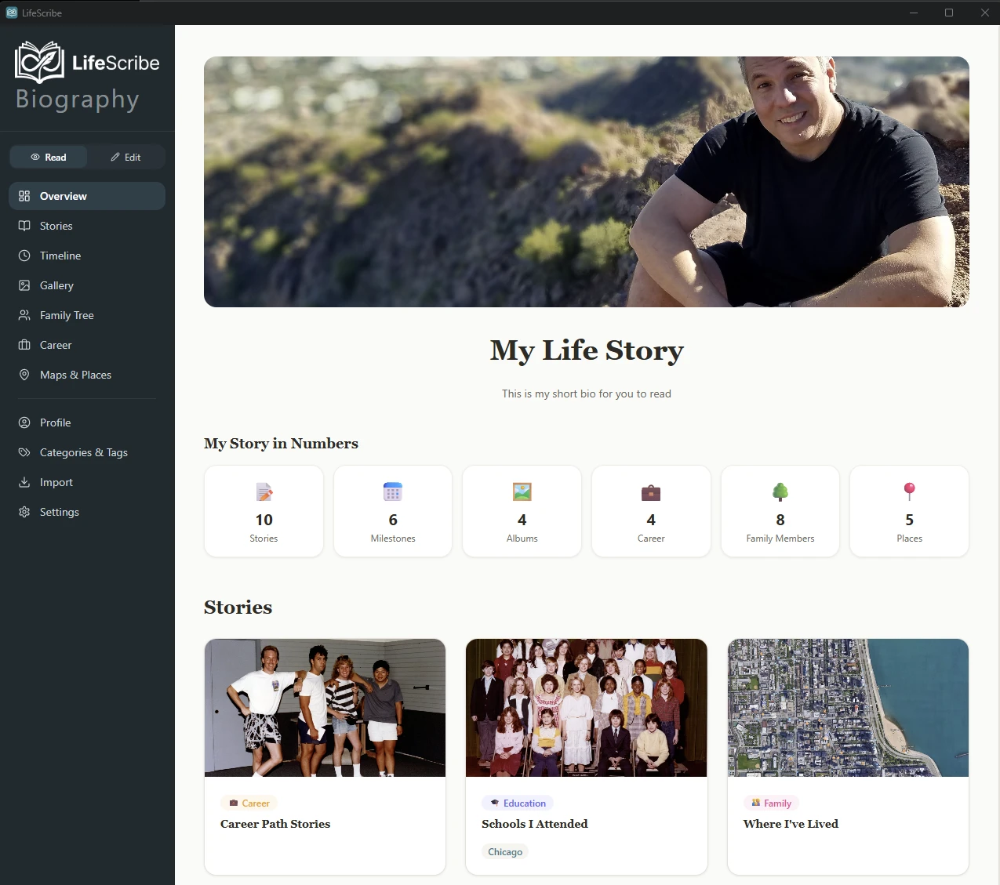

# LifeScribe Biography

[](https://github.com/krynsky/LifeScribe-Biography/releases/latest)
[](LICENSE)
[](docs/DEVELOPMENT.md#release)
[](docs/DEVELOPMENT.md#release)
[](https://tauri.app)
[](https://react.dev)
[](https://www.rust-lang.org)

A local desktop app for writing and preserving your life story. Capture your stories, timeline, photo albums, family tree, career history, and the places that mattered — all in one biography that lives on your own computer, with nothing sent to a server and no account to create.

- 🏠 **Fully local** — your biography lives in a database and a folder you choose, and works offline
- ✍️ **A real writing tool** — a rich-text story editor with photos, tables, video and map embeds, and links between your stories
- 🌳 **Everything in one place** — stories, timeline, gallery, family tree, career, and map of places
- 📖 **Read mode** — flip the whole app into a finished, read-only view of your biography to proofread or share
- 📥 **Fill it fast** — import a folder of photos, or your Facebook, Instagram, or LinkedIn history, and review what it finds

**Platform:** Windows (x64); macOS (universal, unsigned) builds come from a GitHub Actions workflow
**Status:** Active development

> The macOS build is not code-signed or notarized (no Apple Developer account). macOS will warn "Apple could not verify this app" the first time you open it — right-click the app and choose **Open** to bypass this, once. No macOS release has been published yet.

**[⬇ Download the latest release](https://github.com/krynsky/LifeScribe-Biography/releases/latest)** — Windows (x64) installers (`.exe` and `.msi`).

[](https://www.buymeacoffee.com/krynsky)



---

## Table of Contents

- [What It Does](#what-it-does)
- [Privacy and Your Data](#privacy-and-your-data)
- [Tech Stack](#tech-stack)
- [Architecture](#architecture)
- [Development](#development)
- [Releasing](#releasing)
- [Documentation](#documentation)
- [License](#license)

---

## 📖 What It Does

LifeScribe Biography gives your life story a home, organized into sections you reach from one sidebar:

| Section | What you capture |
|---|---|
| **Overview** | Your biography at a glance — title, bio, banner, and a count of everything you've added |
| **Stories** | Long-form writing in a rich-text editor — headings, lists, tables, photos, YouTube/Vimeo and Google Maps embeds, links to other stories, with draft and published states |
| **Timeline** | Milestones — births, graduations, moves, weddings — with dates as precise as a day or as loose as a year |
| **Gallery** | Photos and videos organized into albums, with captions, covers, and photos added from a folder, a link, or your computer |
| **Family Tree** | People and how they relate — parents, children, siblings, spouses (including divorced), shown as a tree you can re-center on anyone |
| **Career** | Jobs and education, with organization, title, dates, location, and logo |
| **Maps & Places** | Places that matter, pinned on an interactive map with place search, notes, and photos |
| **Profile** | Your biography's title, bio, banner image, and the formal name of the person it's about |
| **Categories & Tags** | One shared set of categories for every section, and tags for stories and albums |
| **Import** | Photos from a folder, and Facebook, Instagram, and LinkedIn data exports, reviewed before anything is added |

Stories, milestones, albums, career entries, and places can all link to each other, so a place can point to the story and album about it. A **Read | Edit** toggle at the top of the sidebar switches the whole app between editing and a clean, read-only presentation of everything you've written.

---

## 🔐 Privacy and Your Data

- **Local-first** — no account, no sync, no telemetry, and no connection to any LifeScribe website
- **You choose where it lives** — Settings → Data location moves your database, images, imported photos, and backups to any folder, such as another drive. The old copy is left in place as a safety copy
- **Your own images** — pictures you add are copied into the data folder so your biography keeps working if the originals move
- **Not encrypted** — the database and images are ordinary files. Use your operating system's disk encryption if you need the data protected at rest
- **Backing up is copying a folder** — close the app and copy the data folder to another drive
- **Optional network use only** — the map loads tiles from OpenStreetMap, place search uses OpenStreetMap's search service, and some video embeds fetch a thumbnail. Nothing else leaves your computer

The last version that could sync with lifescribe.us is preserved as the git tag `v1-web-connected` (branch `archive/web-connected`).

---

## 🧰 Tech Stack

| Layer | Technology |
|---|---|
| Desktop shell | Tauri 2 (Rust backend, webview frontend) |
| UI | React 19, TypeScript, Tailwind CSS 4, Vite |
| Routing and state | TanStack Router (code-based route tree), Zustand |
| Rich text | Tiptap 2 (content stored as JSON) |
| Database | SQLite via `tauri-plugin-sql` |
| Photos and archives | Rust (`image`, EXIF, ZIP) for thumbnails, metadata, and unpacking exports |
| Maps | Leaflet with OpenStreetMap |
| Testing | Vitest (the data layer runs against an in-memory SQLite) |

---

## 🏗️ Architecture

### Frontend and Rust split
TypeScript owns the business logic, UI state, SQL, and parsing of social media exports. Rust is only used where native speed or file access matters: scanning folders for photos, reading EXIF data, generating thumbnails, unpacking ZIP archives, and managing the data location.

### Read and Edit modes
Every section route renders either an editor page (`src/pages/*`) or a read-only view (`src/views/*`) inside one shared shell, switched by the Read | Edit toggle. Editing a record opens its own page, the same way for stories, milestones, career entries, places, family members, and albums.

### Data layer
A single SQLite file (`lifescribe.db`) is opened through `tauri-plugin-sql`. Schema changes are numbered migrations in `src/lib/migrations.ts`, tracked in a `_migrations` table and run at startup. Data-access functions take an injected `SqlRunner`, so the same code runs against the app's database and against an in-memory SQLite in tests. Categories, tags, and the links between records are shared tables rather than copies on each record.

### Data location
By default the database lives in the app's config folder and everything else in its local data folder. If you pick a folder, a small pointer file in the config folder names it, and all paths resolve through `src/lib/data-location.ts`. Moving data backs up, copies the database and folders, and rewrites the saved file paths in the copy only — the original is never changed. If the chosen folder can't be reached, the app says so instead of starting a fresh biography elsewhere.

### Import pipeline
Photos are scanned and processed in Rust and added to the gallery, skipping duplicates. A social media export is unpacked, detected as Facebook, Instagram, or LinkedIn, and parsed into suggested stories, milestones, and career entries. Suggestions wait in a review queue; only the ones you accept become part of your biography.

### Family tree
The tree uses `react-family-tree` for layout. `src/lib/family-nodes.ts` turns people and relationships into its input: co-parents of a child count as a couple, divorced marriages are marked, children are ordered oldest first, and anyone outside the centered person's own line is listed under the chart.

---

## 💻 Development

### Prerequisites
- Node.js and [pnpm](https://pnpm.io)
- Rust (stable toolchain, 1.77.2 or newer)
- Tauri 2 system prerequisites (WebView2 and the MSVC build tools on Windows)

### Commands

```sh
# Install dependencies
pnpm install

# Run the full desktop app (starts Vite on port 1421 and builds the Rust side)
pnpm tauri dev

# Run tests and type-check
pnpm test
pnpm exec tsc --noEmit

# Production web build (type-check + Vite)
pnpm build

# Build the Windows installers (.exe and .msi)
pnpm tauri build
```

`pnpm dev` runs the frontend alone in a browser, but the Tauri APIs (database, files) are unavailable there, so use `pnpm tauri dev` for real work.

### Project Structure

```
src/                       # React frontend
  routes/index.tsx         # the whole route tree
  pages/                   # editor pages, one folder per feature
  views/                   # read-mode views
  components/              # layout, editor (Tiptap), gallery, maps, family, settings, ui
  lib/
    db.ts                  # SQLite connection and migration runner
    migrations.ts          # numbered schema migrations
    actions/               # data access, one module per entity
    data/                  # SqlRunner-based data layer (unit-tested)
    models/                # shared TypeScript types
    archive-parsers.ts     # Facebook / Instagram / LinkedIn export parsers
  styles/globals.css       # Tailwind and design tokens

src-tauri/                 # Rust backend
  src/                     # lib.rs, photos.rs, archive.rs, data.rs
  capabilities/            # Tauri permission grants
  tauri.conf.json          # window, asset protocol, bundle settings
  tauri.macos.conf.json    # macOS overrides (dmg target, window size)

branding/                  # official logo source and the icon generator
docs/                      # user guide, developer guide, release notes, archive
.github/workflows/         # macOS build workflow
```

### Testing Conventions
- Vitest, with tests colocated as `*.test.ts` next to the code
- The data layer and migrations run against an in-memory SQLite (`better-sqlite3`), so tests never touch your real biography
- Code that needs the Tauri runtime (Rust commands, the SQL plugin) isn't covered by unit tests — check it by running `pnpm tauri dev`

---

## 🚀 Releasing

1. Bump the version in `package.json`, `src-tauri/tauri.conf.json`, `src-tauri/Cargo.toml`, and the `lifescribe` entry in `src-tauri/Cargo.lock`. The sidebar and Settings read the version from the app.
2. Write the release notes in `docs/releases/vX.Y.Z.md`, commit, and tag `vX.Y.Z`.
3. Build the Windows installers with `pnpm tauri build` and attach the files from `src-tauri/target/release/bundle/` to a GitHub release.
4. For macOS, run the **macOS build** workflow from the repository's Actions tab. Enter the release tag to attach the `.dmg` to that release.

---

## 📚 Documentation

**Current — describes how the app works today:**

- `docs/USER_GUIDE.md` — user-facing guide for people who use the app
- `docs/DEVELOPMENT.md` — developer guide (architecture, layout, conventions)
- `docs/releases/` — release notes for each version
- `branding/README.md` — how the logo and icons are generated

**Historical — dated design records, kept for rationale:**

- `docs/archive/` — specs and plans for the removed website sync feature
- `docs/superpowers/` — design specs and plans for other features
- `2026-06-06-001-feat-lifescribe-desktop-app-plan.md` — the original desktop app plan

Historical documents describe what was decided at the time. Some describe systems since removed — website sync is the big one. Read them for *why*; where they disagree with `docs/DEVELOPMENT.md` or the code, they are out of date.

---

## 📄 License

MIT — see [LICENSE](LICENSE) for the full text.
